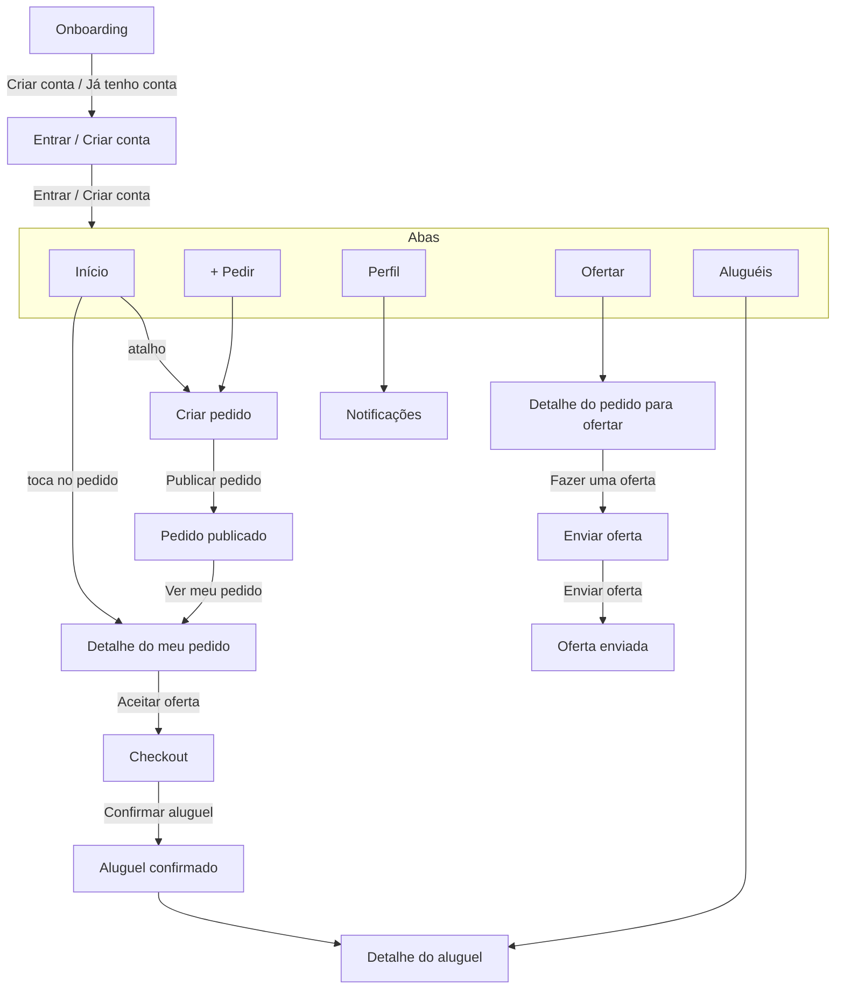

# Design Document

## Visão geral

Protótipo navegável do JALUGA (Fase 1) em React Native + Expo (TypeScript strict), com Expo Router, NativeWind, Zustand e `lucide-react-native`. Todas as 13 telas leem dados de `src/mocks/` e das stores Zustand. Não há rede, backend nem regras de negócio. Os requisitos estão em `requirements.md` (R1 a R22).

### Princípios de design

- **Telas só compõem.** Rotas em `app/` montam componentes de `src/components/` e leem mocks ou stores (steering `structure.md`).
- **Uma fonte de tokens.** Cores, fontes e sombra saem de um único arquivo (`src/theme/tokens.js`) usado pelo `tailwind.config.js` e pelo código que precisa de valores brutos (sombra, ícones, `Svg`). Assim não há hex solto no código (R1.1, R1.2).
- **Sem cálculo.** Nenhum componente soma, multiplica ou valida regras. O único código de formatação é `formatBRL(valor)`, que só transforma número em texto.
- **Só dependências do Expo Go.** Sem módulos nativos customizados (R21.7).
- **Sem imagens de itens nem de mapa em arquivo.** Itens usam `ItemPlaceholder` (ícone Lucide sobre `primary-100`). O mapa ilustrativo é um componente SVG. Evita fotos de pessoas e problemas de direitos (R18.8, R11.2). O único arquivo de imagem do app é o mascote.

### Dependências

| Pacote | Uso |
|---|---|
| `expo`, `expo-router`, `expo-font`, `expo-splash-screen`, `expo-status-bar` | base, rotas, fontes |
| `nativewind`, `tailwindcss` (3.x), `react-native-reanimated`, `react-native-safe-area-context`, `react-native-screens` | estilos e áreas seguras |
| `@expo-google-fonts/nunito`, `@expo-google-fonts/inter` | fontes (R1.3) |
| `lucide-react-native`, `react-native-svg` | ícones, hexágono, mapa ilustrativo |
| `zustand` | estado em memória |
| `expo-image-picker` | abre a galeria no `PhotoPicker` (R2.10) |
| `@react-native-community/datetimepicker` | seletor de data e hora no `DateRangePicker` |

A tarefa 1 confirma as versões compatíveis com o SDK do Expo Go instalado (`npx expo install`).

## Estrutura de pastas

```
jaluga-app/
├── app/                                  # rotas (Expo Router)
├── assets/
│   └── brand/jabuti.png                  # mascote
├── docs/
├── src/
│   ├── components/                       # um componente por arquivo
│   ├── hooks/                            # useListaEstado
│   ├── mocks/                            # dados tipados
│   ├── store/                            # stores Zustand
│   ├── theme/                            # tokens, fontes, sombra
│   ├── types/                            # tipos dos mocks
│   └── utils/                            # formatBRL
├── global.css                            # diretivas do Tailwind
├── babel.config.js
├── metro.config.js
├── nativewind-env.d.ts
├── tailwind.config.js
├── tsconfig.json                         # "strict": true
└── package.json
```

## Rotas do Expo Router

```
app/
├── _layout.tsx                  # fontes, SafeAreaProvider, Stack raiz, splash
├── index.tsx                    # redireciona para /(onboarding)
├── (onboarding)/
│   └── index.tsx                # Tela 1: Onboarding
├── (auth)/
│   └── entrar.tsx               # Tela 2: Entrar / Criar conta
├── (tabs)/
│   ├── _layout.tsx              # TabBar: Início · Ofertar · + Pedir · Aluguéis · Perfil
│   ├── inicio.tsx               # Tela 3: Início
│   ├── ofertar.tsx              # Tela 7: Ofertar (pedidos perto de mim)
│   ├── pedir.tsx                # só âncora da aba central; o botão abre /pedido/novo
│   ├── alugueis.tsx             # Tela 12: Aluguéis
│   └── perfil.tsx               # Tela 13: Perfil (+ Modo_Teste oculto)
├── pedido/
│   ├── novo.tsx                 # Tela 4: Criar pedido (3 passos + revisão)
│   ├── publicado.tsx            # Tela 5: Pedido publicado
│   └── [id].tsx                 # Tela 6: Detalhe do meu pedido
├── ofertar/
│   ├── [id].tsx                 # Tela 8: Detalhe do pedido (para ofertar)
│   ├── [id]/oferta.tsx          # Tela 9: Enviar oferta
│   └── enviada.tsx              # sucesso: Oferta enviada
├── checkout/
│   └── [ofertaId].tsx           # Tela 10: Checkout
├── aluguel/
│   ├── confirmado.tsx           # sucesso: Aluguel confirmado
│   └── [id].tsx                 # Tela 11: Detalhe do aluguel
└── notificacoes.tsx             # Notificações (Tela 13)
```

**Decisões:**
- Os grupos `(onboarding)`, `(auth)` e `(tabs)` ficam como irmãos no Stack raiz. O Onboarding e o login usam `router.replace` para entrar no app, e por isso o botão voltar do celular não retorna a eles (R3.9).
- A aba central `pedir` não tem tela própria. O `tabBarButton` customizado chama `router.push('/pedido/novo')` (R3.6). A rota existe só para ocupar o slot.
- Telas de detalhe e fluxos ficam no Stack raiz, acima das abas, sem TabBar.
- Telas de sucesso usam `router.replace` para o próximo destino, assim voltar não retorna ao formulário.

### Mapa de navegação



## Tema

### `src/theme/tokens.js` (CommonJS, fonte única)

```js
// Cores da paleta (seção 4.3 do briefing). Nenhuma outra é permitida.
const colors = {
  primary: {
    50: '#F8F5FF', 100: '#EDE4FF', 300: '#B394F0',
    600: '#6C2BD9', 700: '#5A22B8', 900: '#2A0E5C',
  },
  accent: { 400: '#FFC93C', 700: '#C98A00' },
  'text-muted': '#6E6090',
  border: '#E3D8FA',
  success: '#1F9D55',
  danger: '#D64545',
  white: '#FFFFFF',
};

const fontFamily = {
  title: ['Nunito_700Bold'],
  'title-xbold': ['Nunito_800ExtraBold'],
  body: ['Inter_400Regular'],
  'body-medium': ['Inter_500Medium'],
  'body-semibold': ['Inter_600SemiBold'],
};

// Escala 12/14/16/18/20/24/32/40. Corpo com linha 1,5. Títulos com linha 1,2.
const fontSize = {
  'body-12': ['12px', { lineHeight: '18px' }],
  'body-14': ['14px', { lineHeight: '21px' }],
  'body-16': ['16px', { lineHeight: '24px' }],
  'body-18': ['18px', { lineHeight: '27px' }],
  'title-18': ['18px', { lineHeight: '22px' }],
  'title-20': ['20px', { lineHeight: '24px' }],
  'title-24': ['24px', { lineHeight: '29px' }],
  'title-32': ['32px', { lineHeight: '38px' }],
  'title-40': ['40px', { lineHeight: '48px' }],
};

const spacing = { 1: '4px', 2: '8px', 3: '12px', 4: '16px', 6: '24px', 8: '32px', 12: '48px' };
const borderRadius = { card: '12px', control: '8px', pill: '999px' };

// Sombra (RN não usa Tailwind para isso; ver src/theme/shadow.ts)
const shadow = { color: '#2A0E5C', opacity: 0.08, offset: { width: 0, height: 2 }, radius: 8, elevation: 2 };

module.exports = { colors, fontFamily, fontSize, spacing, borderRadius, shadow };
```

`src/theme/tokens.d.ts` declara os tipos do módulo, para uso em TypeScript.

### `tailwind.config.js`

```js
const { colors, fontFamily, fontSize, spacing, borderRadius } = require('./src/theme/tokens');

module.exports = {
  content: ['./app/**/*.{ts,tsx}', './src/**/*.{ts,tsx}'],
  presets: [require('nativewind/preset')],
  theme: {
    colors,          // substitui a paleta padrão: só as cores da Paleta existem
    fontFamily,
    fontSize,
    spacing,         // 4, 8, 12, 16, 24, 32, 48 pt
    borderRadius,    // rounded-card, rounded-control, rounded-pill
    extend: {},
  },
};
```

`theme.colors` (e não `extend`) remove as cores padrão do Tailwind. Usar `bg-red-500` deixa de funcionar, e isso garante R1.2. O `spacing` também é substituído e inclui a margem lateral de 16 pt (`px-4`). Valores extras de altura, como a área de toque de 44 pt, usam `min-h-[44px] min-w-[44px]`.

### Outros arquivos de tema

- `src/theme/colors.ts`: reexporta `colors` do `tokens.js` com tipos. Usado onde a cor vai em prop e não em classe (ícones Lucide, `Svg fill`, `ActivityIndicator`).
- `src/theme/shadow.ts`: exporta `shadowCard` com `shadowColor`, `shadowOpacity: 0.08`, `shadowOffset: { width: 0, height: 2 }`, `shadowRadius: 8` e `elevation: 2`, lidos de `tokens.shadow`.
- `src/theme/fonts.ts`: exporta o mapa de fontes para `useFonts` (`Nunito_700Bold`, `Nunito_800ExtraBold`, `Inter_400Regular`, `Inter_500Medium`, `Inter_600SemiBold`).

### Carregamento de fontes (R1.4)

`app/_layout.tsx` chama `SplashScreen.preventAutoHideAsync()` e usa `useFonts`. O Stack só renderiza quando as fontes carregam. Depois disso chama `SplashScreen.hideAsync()`.

### Contraste (R20.1)

| Combinação | Uso | Observação |
|---|---|---|
| `primary-900` sobre `primary-50` / `white` | texto principal | contraste alto |
| `primary-600` sobre `white` | links e botões | cerca de 7:1 (briefing 4.3) |
| `white` sobre `primary-600` / `primary-700` | texto de botão | AA |
| `primary-900` sobre `accent-400` | botão "+ Pedir", badge | AA |
| `accent-400` sobre `primary-900` | "JA" no fundo escuro | permitido |
| `text-muted` sobre `primary-50` / `white` | texto secundário | tarefa 8 mede e confirma AA |
| `white` sobre `success` / `danger` | badges | tarefa 8 mede e confirma AA |

`accent-400` nunca é cor de texto sobre fundo claro (R1.11). Onde faltar contraste AA, o componente usa texto `primary-900` sobre `primary-100`, e a tarefa 8 corrige o que ficar abaixo de 4,5:1.

## Componentes

Todos em `src/components/<Nome>.tsx`, funcionais, uma exportação por arquivo, props tipadas, sem import de `app/` (R2.2). Elementos interativos têm `accessibilityRole`, `accessibilityLabel` e área mínima de 44 × 44 pt.

### Base e marca

| Componente | Props | Observações |
|---|---|---|
| `Logo` | `variant: 'claro' \| 'escuro'`, `size?: 'sm' \| 'md' \| 'lg'` | "JA" e "LUGA" nas cores do R1.10. Fonte Nunito 800 |
| `Hexagono` | `size: number`, `fill: Cor`, `stroke?: Cor`, `children?: ReactNode` | `react-native-svg`. Base do avatar, do badge de nota e do carregamento |
| `LoadingHexagono` | `size?: number` | Hexágono girando (`Animated`) |
| `Mascote` | `size: number`, `pose?: 'normal' \| 'comemorando'` | Usa `jabuti.png`. Fase 1 usa a mesma imagem nas duas poses |
| `ItemPlaceholder` | `icone: IconeItem`, `size?: number` | Ícone Lucide sobre `primary-100`. Usado no lugar de fotos |
| `MapaIlustrativo` | `bairro: string` | SVG estático. Sem geolocalização (R11.2) |

### Ações e formulário

| Componente | Props |
|---|---|
| `Button` | `title: string`, `onPress: () => void`, `variant?: 'primario' \| 'secundario' \| 'fantasma' \| 'perigo'`, `disabled?: boolean`, `icon?: LucideIcon`, `fullWidth?: boolean`, `accessibilityLabel?: string` |
| `Input` | `label: string`, `value: string`, `onChangeText: (t: string) => void`, `placeholder?: string`, `error?: string`, `secureTextEntry?: boolean`, `keyboardType?: KeyboardTypeOptions`, `required?: boolean` |
| `TextArea` | `label`, `value`, `onChangeText`, `placeholder?`, `error?`, `required?`, `numberOfLines?: number` |
| `Select` | `label: string`, `value: string \| null`, `options: { value: string; label: string }[]`, `onChange: (v: string) => void`, `error?: string`, `placeholder?: string` |
| `DateRangePicker` | `inicio: Date \| null`, `fim: Date \| null`, `onChange: (r: { inicio: Date \| null; fim: Date \| null }) => void`, `error?: string` |
| `PhotoPicker` | `fotos: string[]`, `onChange: (uris: string[]) => void`, `max?: number`, `label?: string` |
| `CategoryChip` | `categoria: Categoria`, `selecionada?: boolean`, `onPress?: () => void` |
| `RaioSelector` | `value: number`, `onChange: (km: number) => void`, `opcoes: number[]` (seletor visual do raio, R7.4) |
| `OpcaoCard` | `titulo: string`, `descricao?: string`, `selecionada: boolean`, `onPress: () => void`, `icon?: LucideIcon` (entrega/retirada, Pix/cartão) |

### Exibição

| Componente | Props |
|---|---|
| `Header` | `titulo?: string`, `onBack?: () => void`, `variant?: 'claro' \| 'escuro'`, `acaoDireita?: ReactNode` |
| `TabBar` | `state`, `descriptors`, `navigation` (props do Expo Router `tabBarComponent`). Desenha o botão central amarelo (`accent-400` com ícone `primary-900`) |
| `BottomActionBar` | `children: ReactNode` (normalmente um `Button`). Fixa embaixo, usa `useSafeAreaInsets().bottom` |
| `StatusBadge` | `status: StatusBadgeTipo`, `rotulo?: string` |
| `Avatar` | `size?: number`, `nome: string`, `verificado?: boolean`, `cor?: 'padrao'` (hexágono com iniciais) |
| `Rating` | `nota: number`, `variant?: 'hexagono' \| 'estrelas'`, `total?: number` |
| `RequestCard` | `pedido: Pedido`, `quantidadeOfertas: number`, `onPress: () => void` |
| `PedidoVizinhoCard` | `pedido: Pedido`, `dono: Usuario`, `onPress: () => void` (card da Tela 7) |
| `OfferCard` | `oferta: Oferta`, `ofertante: Usuario`, `onPress?: () => void`, `selecionada?: boolean` |
| `OfferComparator` | `ofertas: { oferta: Oferta; ofertante: Usuario }[]`, `onSelecionar?: (ofertaId: string) => void` |
| `RentalTimeline` | `etapaAtual: EtapaAluguel` (linha tracejada `primary-300`, etapa atual destacada) |
| `AluguelCard` | `aluguel: Aluguel`, `onPress: () => void` |
| `ResumoLinha` | `rotulo: string`, `valor: number`, `destaque?: boolean` (linhas do Checkout e da caixa de resumo; só exibe) |
| `NotificacaoItem` | `notificacao: Notificacao` |
| `EmptyState` | `titulo: string`, `descricao?: string`, `mostrarMascote?: boolean` (padrão `true`), `acao?: { rotulo: string; onPress: () => void }` |
| `Skeleton` | `width?: number \| string`, `height: number`, `radius?: 'card' \| 'control' \| 'pill'` |
| `SkeletonCard` | `variant: 'pedido' \| 'oferta' \| 'aluguel' \| 'notificacao'` |
| `Lista` | `estado: ListaEstado`, `dados: T[]`, `renderItem`, `keyExtractor`, `vazio: EmptyStateProps`, `skeleton: SkeletonVariant`, `skeletonCount?: number` (aplica o Estado_De_Lista, R17) |
| `FeedbackToast` | `mensagem: string`, `visivel: boolean`, `onFechar: () => void` (aviso "só visual", R14.4) |
| `TelaSucesso` | `titulo: string`, `descricao?: string`, `acoes: ReactNode` (layout das 3 telas de sucesso, com o `Mascote`) |
| `Screen` | `children`, `scroll?: boolean`, `comBottomBar?: boolean`, `fundo?: 'claro' \| 'escuro'` (SafeArea, margem de 16 pt e espaço para a `BottomActionBar`) |

### Regras de composição

- **Mascote só em três lugares:** `EmptyState`, `TelaSucesso` e Onboarding. Nenhum outro componente importa `Mascote` (R19).
- **Skeleton e EmptyState** vivem dentro de `Lista`. Cada tela de lista passa só as props.
- **`TabBar`** não importa rotas. Recebe `onPedirPress` por prop e o layout das abas injeta a navegação.

## Tipos e formato dos mocks

Arquivos TypeScript em `src/mocks/` (sem `fetch`, sem JSON em tempo de execução). Os tipos ficam em `src/types/`. Valores monetários são números em reais, **fixos nos mocks**. Nenhum valor é derivado de outro.

### `src/types/`

```ts
// categoria.ts
export type CategoriaId =
  | 'ferramentas' | 'festas' | 'viagem' | 'bebe' | 'mudanca'
  | 'tecnologia' | 'saude' | 'ocasioes' | 'outros';
export interface Categoria { id: CategoriaId; nome: string; icone: IconeItem; }

// usuario.ts
export interface Usuario {
  id: string; nome: string; bairro: Bairro;
  nota: number; totalAlugueis: number;
  verificado: boolean; avaliacoes: Avaliacao[];
}
export type Bairro = 'Centro' | 'Mogilar' | 'Vila Oliveira' | 'Braz Cubas' | 'César de Souza' | 'Socorro';
export interface Avaliacao { id: string; autorId: string; nota: number; comentario: string; }

// pedido.ts
export type StatusPedido = 'aberto' | 'aguardando_pagamento';
export interface Pedido {
  id: string; donoId: string; titulo: string; categoriaId: CategoriaId;
  descricao: string; bairro: Bairro; distanciaKm: number; raioKm: number;
  inicio: string; fim: string;       // texto de exibição, ex.: "Sáb, 14 jun · 08h"
  status: StatusPedido; icone: IconeItem;
}

// oferta.ts
export type Porte = 'P' | 'M' | 'G';
export type Modalidade = 'entrega' | 'retirada';
export interface Oferta {
  id: string; pedidoId: string; ofertanteId: string;
  nomeItem: string; icone: IconeItem; porte: Porte;
  conservacao: string; mensagem: string;
  distanciaKm: number; precoTotal: number; precoPorDia: number;
  modalidades: Modalidade[];
}

// aluguel.ts
export type EtapaAluguel = 'confirmado' | 'entrega' | 'em_uso' | 'devolucao' | 'concluido';
export type PapelAluguel = 'alugando' | 'ofertando';
export interface ResumoFinanceiro {
  aluguel: number; taxaServico: number; frete: number; caucao: number; total: number; // fixos
}
export interface Aluguel {
  id: string; ofertaId: string; pedidoId: string;
  papel: PapelAluguel; outraParteId: string;
  nomeItem: string; icone: IconeItem; periodo: string;
  etapa: EtapaAluguel; modalidade: Modalidade;
  resumo: ResumoFinanceiro;
}

// notificacao.ts
export interface Notificacao { id: string; titulo: string; texto: string; quando: string; lida: boolean; }

// ui.ts
export type ListaEstado = 'dados' | 'vazio' | 'carregando';
export type StatusBadgeTipo =
  | 'aberto' | 'enviada' | 'aguardando_pagamento' | 'confirmado' | 'em_uso'
  | 'concluido' | 'atrasado' | 'disputa' | 'cancelado';
export type IconeItem = 'furadeira' | 'som' | 'mala' | 'cadeirinha' | 'barraca' | 'lavadora' | 'projetor' | 'generico';
```

### Arquivos de mock

| Arquivo | Conteúdo (R18) |
|---|---|
| `categorias.ts` | As 9 categorias |
| `usuarios.ts` | 6 usuários, um em cada bairro. **Tiago** (Centro) é o usuário logado, exportado como `USUARIO_LOGADO_ID`. Os outros 5 são fictícios, sem foto |
| `pedidos.ts` | Os 7 pedidos: furadeira para o sábado, caixa de som para aniversário e mala grande para viagem pertencem a Tiago ("Meus pedidos"). Cadeirinha de carro, barraca de camping, lavadora de alta pressão e projetor para ver o jogo pertencem aos vizinhos (aba Ofertar) |
| `ofertas.ts` | De 2 a 4 ofertas por pedido, com preço por dia a partir de R$ 15, mistura de entrega e retirada. O `precoTotal` é escrito à mão, não calculado |
| `alugueis.ts` | 5 aluguéis, um por `EtapaAluguel`, com `resumo` fixo. Dois são "Estou ofertando" e três "Estou alugando", para as duas abas terem dados |
| `notificacoes.ts` | Lista simulada de notificações |
| `referencia.ts` | Valores de referência para o Checkout e a caixa de resumo da Tela 9. Taxa de serviço de 25% e caução por faixa **aparecem como números escritos à mão**, sem função de cálculo |
| `index.ts` | Reexporta tudo e oferece buscas simples por `id` (`getPedido`, `getOfertasDoPedido`, `getUsuario`) que só fazem `find` e `filter` |

`getOfertasDoPedido` devolve `[]` para um pedido criado em memória. Por isso o Detalhe do meu pedido mostra o `EmptyState` nesse caso (R6.5, R9.6).

### Exibição financeira

`src/utils/formatBRL.ts` converte número em texto (`R$ 1.234,50`) com `Intl.NumberFormat('pt-BR')`. Nenhuma outra função monetária existe (R21.2). O Checkout usa os valores de `Aluguel.resumo` ou `referencia.ts` e escolher entrega ou retirada não altera os números (R13.6).

## Estado (Zustand, só em memória)

```ts
// src/store/pedidosStore.ts
interface RascunhoPedido {
  titulo: string; categoriaId: CategoriaId | null; descricao: string; fotos: string[];
  inicio: Date | null; fim: Date | null; bairro: Bairro | null; raioKm: number;
}
interface PedidosState {
  rascunho: RascunhoPedido;
  pedidosCriados: Pedido[];            // aparecem em "Meus pedidos" (R6.5)
  atualizarRascunho: (p: Partial<RascunhoPedido>) => void;
  publicarRascunho: () => string;      // cria Pedido com status 'aberto', limpa o rascunho, devolve o id
  limparRascunho: () => void;
}

// src/store/listaEstadoStore.ts
interface ListaEstadoState {
  estado: ListaEstado;                 // padrão: 'dados' (Modo_Teste)
  setEstado: (e: ListaEstado) => void;
}
```

- `publicarRascunho` só monta um objeto `Pedido` com id novo, textos de data formatados do rascunho e `status: 'aberto'`. Não valida nada além da checagem visual de campos obrigatórios feita na tela (R7.7).
- `useListaEstado()` (em `src/hooks/`) lê `listaEstadoStore` e devolve `ListaEstado`. Toda tela de lista usa esse hook e passa o valor para `Lista` (R17.1).
- O Modo_Teste é um painel dentro do Perfil. Abre com 5 toques seguidos no avatar (R17.5) e oferece três botões: "Com dados", "Vazio" e "Carregando".
- Estado de formulário de uma tela só (Enviar oferta, Checkout, passo atual do Criar pedido) fica em `useState` local, não em store.
- Nada é persistido (sem `persist`, sem AsyncStorage). Fechar o app descarta tudo (R21.8).

## Detalhes por tela

| # | Rota | Composição |
|---|---|---|
| 1 | `(onboarding)/index` | `FlatList` horizontal com `pagingEnabled` (3 páginas, `Mascote`, `Logo` escuro), indicador de páginas, `Button` "Criar conta" e `Button` fantasma "Já tenho conta" |
| 2 | `(auth)/entrar` | `Logo` claro, `Input` e-mail, `Input` senha, `Button` "Entrar", link "Criar conta". Sem `Mascote` (R5.3). Ambos usam `router.replace('/(tabs)/inicio')` |
| 3 | `(tabs)/inicio` | Saudação, atalho grande, `Lista` de `RequestCard` (mocks do Tiago + `pedidosCriados`) |
| 4 | `pedido/novo` | Barra de progresso, `useState` do passo (1, 2, 3, revisão), `BottomActionBar` com "Continuar" e, na revisão, "Publicar pedido" |
| 5 | `pedido/publicado` | `TelaSucesso` com `Share.share({ message: TEXTO_COMPARTILHAR })`. O texto fixo fica em `src/mocks/referencia.ts` |
| 6 | `pedido/[id]` | Resumo, `StatusBadge`, alternância lista/comparar, `Lista` de `OfferCard` ou `OfferComparator`, `BottomActionBar` "Aceitar oferta" |
| 7 | `(tabs)/ofertar` | Faixa de `CategoryChip` com filtro local (`useState`), `Lista` de `PedidoVizinhoCard` |
| 8 | `ofertar/[id]` | Dados do pedido, `Avatar` + dono, `MapaIlustrativo`, `BottomActionBar` "Fazer uma oferta" |
| 9 | `ofertar/[id]/oferta` | Formulário (`Input`, `Select` de porte, `PhotoPicker`, `OpcaoCard`, `TextArea`), caixa de resumo com `ResumoLinha` de `referencia.ts`, `BottomActionBar` "Enviar oferta" |
| 9b | `ofertar/enviada` | `TelaSucesso` "Oferta enviada" |
| 10 | `checkout/[ofertaId]` | Resumo do item e de quem aluga, `OpcaoCard` de entrega/retirada e Pix/cartão, `ResumoLinha` das 5 linhas, aviso de dinheiro guardado, `BottomActionBar` "Confirmar aluguel". Sem `Mascote` (R13.8) |
| 10b | `aluguel/confirmado` | `TelaSucesso` "Aluguel confirmado", botão "Ver aluguel" |
| 11 | `aluguel/[id]` | `RentalTimeline`, dados do item, contato, três botões que abrem `FeedbackToast` (R14.4) |
| 12 | `(tabs)/alugueis` | Abas "Estou alugando" / "Estou ofertando" (estado local), `Lista` de `AluguelCard` |
| 13 | `(tabs)/perfil` e `notificacoes` | Avatar hexagonal, métricas, menu. Só "Notificações" navega. Carteira, Ajuda e Sair mostram `FeedbackToast` ou nada. Modo_Teste oculto. `Lista` de `NotificacaoItem` |

### Navegação sem regras

- **Aceitar oferta** → `router.push('/checkout/' + ofertaId)`. Sem mudança de status.
- **Confirmar aluguel** → `router.replace('/aluguel/confirmado')`, que leva a `/aluguel/[id]` do mock.
- Os Mocks guardam apenas o que é exibido. Nenhuma tela decide etapa, status ou preço.

## Acessibilidade e layout (R20)

- `Screen` aplica `SafeAreaView` nas bordas superior e laterais. A `BottomActionBar` cuida da borda inferior com `useSafeAreaInsets().bottom` e fica `absolute` embaixo. `Screen` reserva `paddingBottom` igual à altura da barra mais a área segura.
- Todo `Pressable` usa `min-h-[44px] min-w-[44px]` e `hitSlop` quando o visual é menor (ícones, indicador de página).
- Telas rolam em `ScrollView`, e o conteúdo usa largura fluida (`w-full`, `flex-1`), sem larguras fixas acima de 360 pt. A tarefa 8 revisa 360 e 430 pt.
- Textos usam os tamanhos da escala. Não usar tamanhos soltos.
- Imagens informativas e ícones de ação têm `accessibilityLabel`. Elementos decorativos usam `accessibilityElementsHidden`.

## Tratamento de erros

Não há erros de rede nem de servidor. O que existe:
- **Campo obrigatório vazio:** a tela mantém o passo e passa `error` ao `Input`, `Select` ou `DateRangePicker` (R2.6, R7.6, R12.3). Mensagens curtas, como "Conte o que você precisa.".
- **Galeria negada:** se o usuário negar a permissão no `PhotoPicker`, o componente mostra uma mensagem curta e segue sem foto (a foto é opcional).
- **Compartilhar cancelado:** `Share.share` cancelado não gera erro na tela.
- **Rota com `id` inexistente:** a tela mostra um `EmptyState` com botão "Voltar", sem travar.

## Verificação

Sem testes automatizados nesta fase (não solicitados). Cada tarefa é verificada manualmente no Expo Go (iOS e Android) e pelo `npx tsc --noEmit`. A tarefa 8 faz a revisão final: roteiro de navegação das 13 telas, estados de lista pelo Modo_Teste, contraste das combinações da tabela, áreas de toque e larguras de 360 e 430 pt. Uma busca no código por `#` hexadecimal fora de `src/theme/tokens.js` confirma que não há cor solta (R1.2).

## Mapeamento de requisitos

| Requisito | Onde é atendido |
|---|---|
| R1 Design system | `tokens.js`, `tailwind.config.js`, `fonts.ts`, `shadow.ts`, `Logo`, `Hexagono` |
| R2 Componentes | Seção Componentes |
| R3 Navegação | Rotas, mapa de navegação, `TabBar` |
| R4 a R16 Telas | Tabela Detalhes por tela |
| R17 Estados de lista | `listaEstadoStore`, `useListaEstado`, `Lista`, `Skeleton`, `EmptyState` |
| R18 Mocks | `src/mocks/` e `src/types/` |
| R19 Mascote | `EmptyState`, `TelaSucesso`, Onboarding (únicos usos) |
| R20 Acessibilidade | `Screen`, `BottomActionBar`, regras de toque e de contraste |
| R21 Restrições | Sem rede, sem cálculo, só `formatBRL`, só dependências Expo Go |
| R22 Aceite | Etapa de verificação (tarefa 8) |

## Pontos em aberto

- **Arquivo do mascote:** `jabuti.png` ainda não foi copiado para `jaluga-app/assets/brand/`. Antes das telas com mascote, o arquivo precisa estar lá. Sem ele, o `Mascote` usa um hexágono com ícone como substituto temporário (a ser trocado quando o arquivo chegar).
- **Pose "comemorando":** só existe uma imagem do mascote. As telas de sucesso usam a mesma imagem (poses novas ficam para a fase 2, briefing 4.6).
- **Telas "só visuais":** "Ver contrato", "Abrir chat" e "Confirmar recebimento" mostram um aviso curto. Se você preferir outro comportamento, é só indicar.
