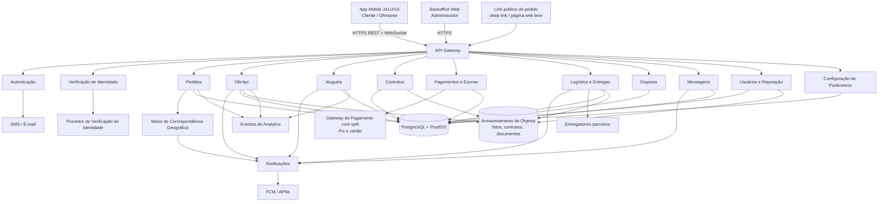
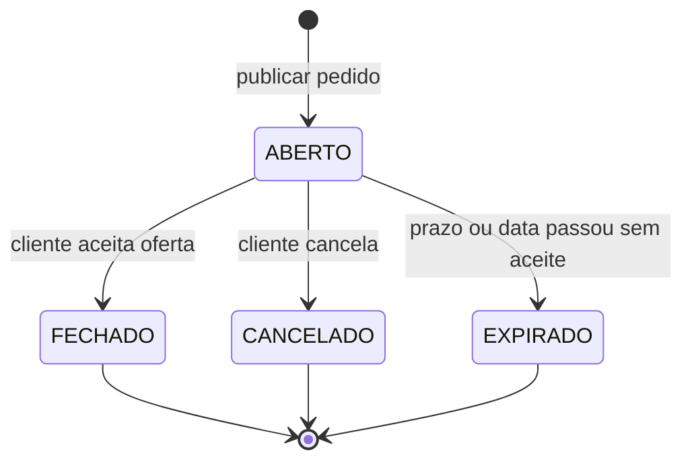
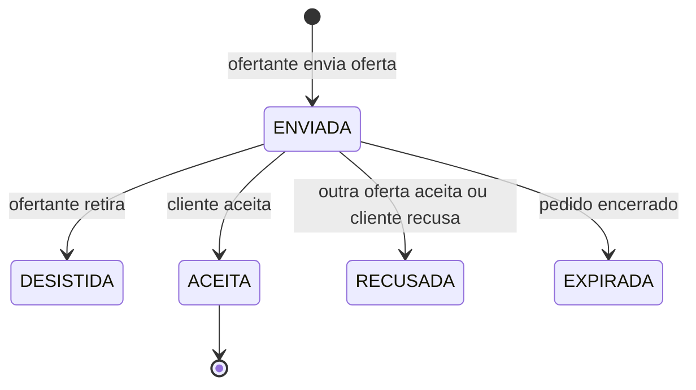
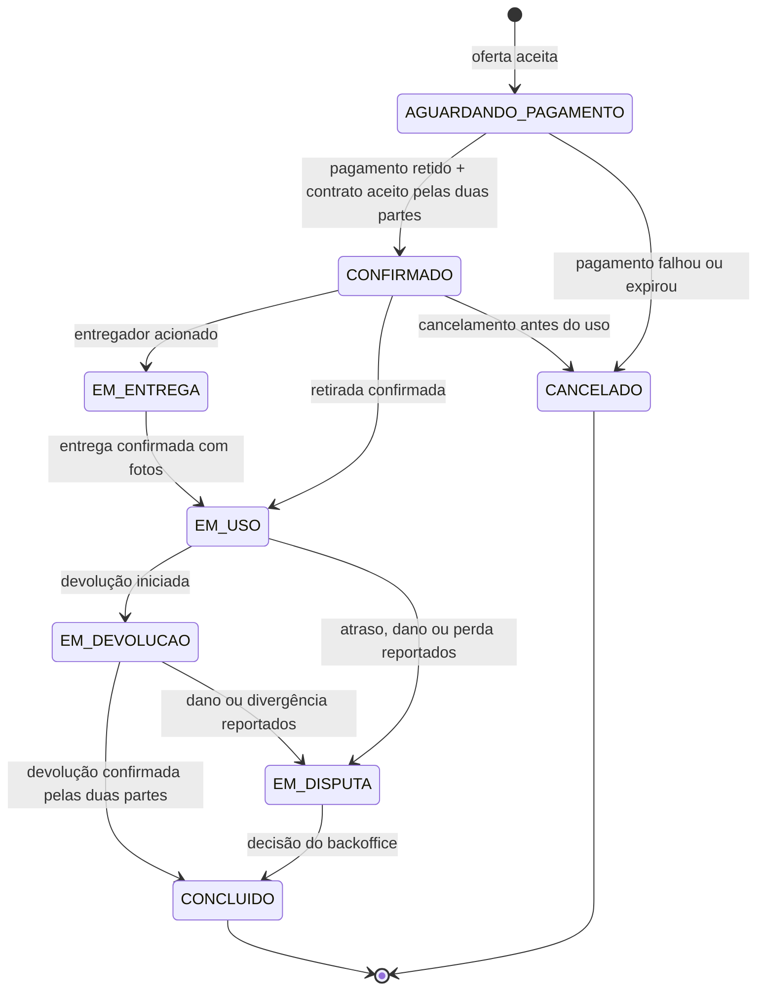
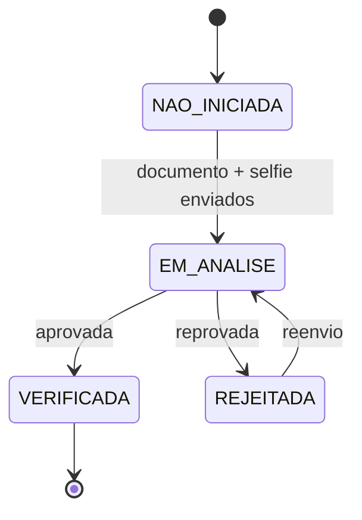
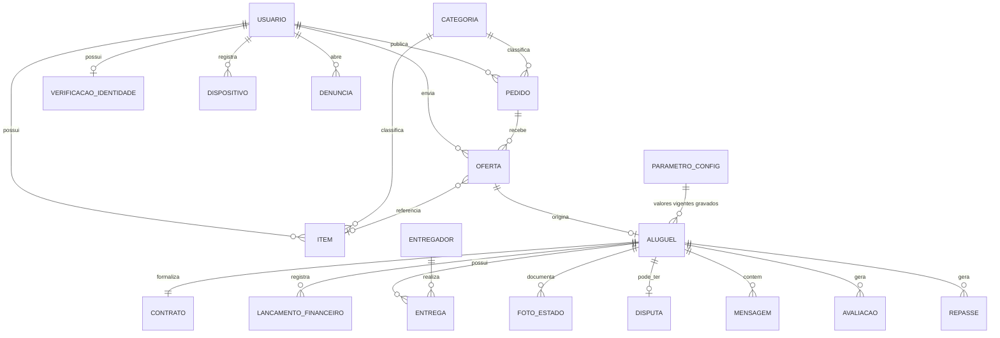

# Documento de Design: JALUGA (Marketplace Reverso de Aluguel P2P)

## Overview

JALUGA ("já aluga") é um aplicativo mobile de aluguel de itens entre pessoas (P2P). Slogan: **"Você pede. O bairro oferta."** O diferencial é a **demanda invertida**: o **cliente** (locatário) publica um **pedido** (item, categoria, data ou período, localização ou raio, fotos de referência opcionais) e os **ofertantes** (locadores) da região que têm o item enviam **ofertas** com preço, condições, fotos, caução e opção de entrega ou retirada. Quem tem o item não cria anúncio, apenas responde a um pedido real.

**Escopo inicial**: Mogi das Cruzes (SP), começando por poucos bairros para criar densidade de ofertas, com expansão posterior para o Alto Tietê. Aceita qualquer item transportável. Não são aceitos: imóveis, veículos, itens ilegais ou perigosos e itens que exigem licença.

**Perfis**:
- **Cliente (locatário)**: publica pedidos e aluga itens.
- **Ofertante (locador)**: responde pedidos e aluga seus itens. A mesma conta pode ter os papéis de cliente e ofertante.
- **Entregador parceiro**: coleta e entrega itens quando o cliente escolhe receber em casa. No MVP é acionado e acompanhado pelo backoffice e por notificações (sem app próprio, que é fase 2).
- **Administrador (backoffice)**: modera, resolve disputas, gerencia verificação de identidade e repasses.

**Confiança e segurança (MVP)**: verificação de identidade (documento + selfie) obrigatória antes de publicar pedidos ou ofertar; pagamento retido (escrow) até a devolução; contrato digital com multa; caução escalonada pelo valor do item; fotos de check-in e check-out; avaliações mútuas; fluxo de disputa mediado pelo backoffice.

**Receita**: comissão sobre cada aluguel fechado (principal). Complementares em fases posteriores: taxa de entrega, destaque pago de ofertas, proteção opcional contra danos. No lançamento, a comissão do ofertante pode ser zerada por alguns meses. Por isso a comissão é um **parâmetro configurável** (por período e por papel), sem valor fixo no código.

**Identidade visual (nota de design system do app)**:
- Cores: roxo principal `#6C2BD9`, roxo escuro `#2A0E5C`, lilás `#EDE4FF`, amarelo de destaque `#FFC93C` (usado no "JA" do nome).
- Mascote: jabuti roxo com casco hexagonal carregando uma caixa (arquivo `jaluga-mascote-jabuti_2.png`). Transmite segurança e cuidado.
- Motivo visual: hexágono (casco), usado em ícones, avatares de status e ilustrações de estados vazios.
- Tom de voz: amigável, próximo, de vizinho.
- Os tokens de cor ficam centralizados no tema do app, para não serem repetidos nas telas.

**Premissas** (a confirmar nos requisitos): idioma pt-BR, moeda BRL; Android e iOS com código único; a lista de **Decisões em aberto** está em seção própria e todos os valores dependentes dela são parâmetros configuráveis.

## Architecture

### Visão de Contexto



### Estilo Arquitetural

Monólito modular no MVP, com fronteiras claras entre módulos (extraíveis depois). REST para comandos e consultas; WebSocket e push para eventos em tempo real (novas ofertas, mensagens, mudanças de estado). Eventos internos assíncronos por fila para correspondência, notificações, analytics e webhooks de pagamento e identidade.

**Decisões de design**:
- Monólito modular em vez de microserviços: equipe e escala iniciais pequenas. Alternativa descartada: microserviços, por custo operacional.
- O módulo de pagamentos fica atrás de uma interface (`PaymentProvider`), porque o gateway ainda não foi escolhido. O mesmo vale para `IdentityProvider` e `DeliveryProvider`.
- Dinheiro é controlado por um **livro-razão (ledger) de partidas dobradas** interno, conciliado com o gateway. O estado de escrow nunca é inferido só do gateway.
- O backoffice é um app web simples, com autenticação e perfil de acesso próprios.

### Fluxo Principal

```mermaid
sequenceDiagram
    participant Cl as Cliente (App)
    participant API as API
    participant M as Correspondência
    participant Of as Ofertante (App)
    participant P as Pagamentos / Escrow
    participant K as Contratos
    participant L as Logística
    participant E as Entregador parceiro

    Cl->>API: Publica pedido (item, data, local, raio)
    API->>API: Exige identidade VERIFICADA; valida; status ABERTO; gera link público
    API-->>Cl: Pedido criado + link compartilhável
    API->>M: Evento PedidoCriado
    M->>Of: Push para ofertantes verificados no raio
    Of->>API: Envia oferta (preço, fotos, caução, entrega/retirada)
    API-->>Cl: Push "Nova oferta"
    Cl->>API: Aceita oferta
    API->>API: Transação: pedido FECHADO, demais ofertas RECUSADAS, Aluguel AGUARDANDO_PAGAMENTO
    API->>P: Cobra aluguel + caução + frete (Pix ou cartão)
    P-->>API: Pagamento confirmado (valores retidos)
    API->>K: Gera contrato (condições, multa, caução)
    K-->>Cl: Solicita aceite
    K-->>Of: Solicita aceite
    Note over API: Aluguel CONFIRMADO quando as duas partes aceitam
    API->>Cl: Libera endereço / ponto de encontro (após pagamento)
    alt Entrega
        API->>L: Solicita entregador (frete por distância)
        L->>E: Aciona coleta e entrega
        E->>Of: Coleta (fotos check-in)
        E->>Cl: Entrega (fotos check-in)
        Note over API: Aluguel EM_ENTREGA, depois EM_USO
    else Retirada
        Cl->>Of: Retira o item (fotos check-in)
    end
    Cl->>API: Inicia devolução (mesmo caminho)
    Note over API: Aluguel EM_DEVOLUCAO (fotos check-out)
    Cl->>API: Confirma devolução
    Of->>API: Confirma devolução
    API->>P: Libera repasse ao ofertante (menos comissão) e devolve caução
    API->>API: Aluguel CONCLUIDO
    Cl->>API: Avalia ofertante
    Of->>API: Avalia cliente
```

### Ciclos de Vida









## Components and Interfaces

### Componente 1: App Mobile

**Propósito**: interface única para cliente e ofertante (mesma conta, alternância de modo).

**Telas principais**: onboarding e cadastro; verificação de identidade; início com alternância "Preciso" e "Quero ofertar"; novo pedido; meus pedidos e detalhe com comparação de ofertas (preço, distância, avaliação); feed de pedidos próximos; nova oferta com fotos; meus itens (opcional); pagamento (Pix e cartão); contrato para aceite; chat; acompanhamento do aluguel (status da entrega, fotos de check-in e check-out); disputa; avaliações; perfil e configurações.

**Responsabilidades**: captura de localização com permissão ou endereço/CEP manual; upload de fotos com compressão; push e atualização em tempo real; deep link do pedido; tema com os tokens do design system (seção Overview).

**Tecnologia**: Flutter ou React Native (decisão em aberto).

### Componente 2: Autenticação

```
POST /auth/register   { telefone|email, senha|código }
POST /auth/login
POST /auth/verify     { código }
POST /auth/refresh
POST /auth/logout
```
Cadastro e login por telefone (SMS) ou e-mail; tokens de acesso curtos e refresh rotacionado.

### Componente 3: Verificação de Identidade

**Propósito**: garantir que só usuários verificados publiquem pedidos ou ofertem.

```
POST /identity/sessions        inicia verificação (retorna sessão do provedor)
GET  /identity/status          NAO_INICIADA | EM_ANALISE | VERIFICADA | REJEITADA
POST /identity/webhook         resultado do provedor (assinado)
```
```
interface IdentityProvider {
  startVerification(userId): ProviderSession
  parseWebhook(payload, signature): VerificationResult
}
```
**Responsabilidades**: guardar apenas o resultado e a referência do provedor (não guardar imagem de documento fora do provedor, salvo exigência); bloquear com 403 (`IDENTIDADE_NAO_VERIFICADA`) as ações de publicar pedido e enviar oferta; permitir revisão manual no backoffice.

### Componente 4: Usuários e Reputação

```
GET   /users/me
PATCH /users/me              { nome, foto, localização padrão, raio }
GET   /users/{id}            perfil público (nome, foto, nota, nº de aluguéis)
GET   /users/{id}/reviews
POST  /rentals/{id}/reviews  { nota 1-5, comentário }
```
Perfil, localização padrão e raio do ofertante, nota média, avaliações mútuas após aluguel concluído.

### Componente 5: Pedidos

```
POST   /requests                 cria pedido
GET    /requests/{id}
GET    /requests/mine
GET    /requests/nearby          ?lat&lng&raio&categoria (feed do ofertante)
PATCH  /requests/{id}            edita (somente ABERTO e sem oferta aceita)
POST   /requests/{id}/cancel
GET    /public/requests/{token}  dados públicos limitados do pedido (link compartilhável)
```
**Responsabilidades**: validar e persistir; exigir identidade verificada; gerar **link público** com token opaco e não adivinhável; expirar automaticamente; publicar `PedidoCriado`; alertar o backoffice e sugerir ao cliente ampliar o raio quando o pedido não recebe ofertas em `T_SEM_OFERTA` horas (parâmetro).

**Link público**: mostra apenas título, categoria, período e área aproximada (bairro). Quem abre é levado, via deep link, ao app ou à loja, e depois ao cadastro ou ao formulário de oferta. Para ofertar, o usuário precisa estar verificado.

### Componente 6: Motor de Correspondência Geográfica

Consulta geoespacial de ofertantes verificados dentro do raio do pedido, filtro por categoria e itens cadastrados, exclusão do autor e de bloqueados, limite de notificações por pedido e por usuário. Reprocessa quando novos ofertantes entram na região. Raio padrão é parâmetro (decisão em aberto).

### Componente 7: Ofertas

```
POST /requests/{id}/offers   cria oferta
GET  /requests/{id}/offers   lista (somente dono do pedido)
GET  /offers/mine
POST /offers/{id}/withdraw
POST /offers/{id}/accept     (cliente)
POST /offers/{id}/reject     (cliente)
```
**Responsabilidades**: exigir preço, fotos do item, valor da caução e opções de entrega ou retirada; uma oferta ativa por ofertante por pedido; aceite atômico (fecha o pedido, recusa as demais, notifica os ofertantes e cria o aluguel AGUARDANDO_PAGAMENTO); validar a caução mínima conforme a escala; publicar `OfertaCriada` e `OfertaAceita`.

### Componente 8: Pagamentos e Escrow

**Propósito**: cobrar, reter, repassar e devolver valores com rastreabilidade.

```
POST /rentals/{id}/payments          cria cobrança (Pix ou cartão)
GET  /rentals/{id}/payments
POST /payments/webhook               eventos do gateway (assinados, idempotentes)
GET  /payouts/mine                   repasses do ofertante
```
```
interface PaymentProvider {
  createCharge(rentalId, amounts, method, idempotencyKey): Charge
  capture / hold(charge): void
  releaseToSeller(chargeId, amount): Transfer     // split
  refundDeposit(chargeId, amount): Refund
  parseWebhook(payload, signature): PaymentEvent
}
```
**Composição da cobrança**: `preço do aluguel + caução + frete (se entrega)`. Quando o gateway permite, aluguel e frete são alocados por split (ofertante, plataforma, entregador) na liberação; a caução fica retida e é tratada separadamente.

**Regras**:
- Comissão = `percentual_vigente * preço do aluguel` (arredondamento em centavos, definido em um único ponto). O percentual vem de configuração versionada (promoção de lançamento pode zerar para ofertantes) e é **gravado no aluguel no momento do aceite**, para não mudar depois.
- **Caução escalonada**: a escala (faixas de valor estimado do item para valor ou percentual da caução) é configuração versionada. Valores finais em aberto.
- Repasse só ocorre quando as duas partes confirmam a devolução e não há disputa aberta.
- Caução volta ao cliente na conclusão sem disputa; com disputa, fica retida até decisão do backoffice.
- Toda operação usa chave de idempotência; webhooks são processados no máximo uma vez efetivamente.
- Reembolso de cancelamento segue política configurável (a definir com validação jurídica).

### Componente 9: Contratos

```
GET  /rentals/{id}/contract
POST /rentals/{id}/contract/accept   (cada parte)
```
Gera contrato digital a partir de um **modelo versionado** com: partes, item, período, preço, caução, multa por atraso/dano/perda, condições da oferta, regras de entrega/devolução. Guarda o PDF e o hash do conteúdo, e registra aceite (usuário, data/hora, versão do modelo, IP/dispositivo). Contrato não pode ser alterado depois do aceite de qualquer parte. O texto do modelo e os valores de multa exigem validação jurídica (decisão em aberto).

### Componente 10: Aluguéis

```
GET  /rentals/{id}
GET  /rentals/mine
POST /rentals/{id}/confirm-pickup
POST /rentals/{id}/start-return
POST /rentals/{id}/confirm-return
POST /rentals/{id}/cancel
POST /rentals/{id}/report-issue
```
Controla a máquina de estados do aluguel; exige confirmações das duas partes nas etapas de retirada/entrega e devolução; exige fotos nas confirmações; libera endereço ou ponto de encontro apenas depois do pagamento retido; dispara repasse e devolução de caução.

### Componente 11: Logística e Entregas

```
POST /rentals/{id}/delivery/quote     calcula frete por distância
POST /rentals/{id}/delivery           solicita entregador (ida)
POST /rentals/{id}/delivery/return    solicita entregador (volta)
GET  /rentals/{id}/delivery
POST /rentals/{id}/photos             { fase: CHECKIN|CHECKOUT, etapa, imagens }
```
```
interface DeliveryProvider {
  quote(origem, destino): Frete
  dispatch(entrega): Atribuição
  onStatus(evento): void
}
```
**Responsabilidades**: frete = função da distância (tabela configurável); acionar entregador parceiro (parceiros locais ou plataforma de terceiros, em aberto); registrar status da entrega; coletar fotos de check-in (entrega) e check-out (devolução) com data/hora; alertar o backoffice quando não há entregador disponível. No MVP não há rastreio em tempo real nem app próprio do entregador (fase 2).

### Componente 12: Disputas

```
POST /rentals/{id}/dispute        abre disputa (atraso, dano, perda)
GET  /disputes/{id}
POST /disputes/{id}/evidence      fotos, texto
POST /admin/disputes/{id}/decide  { decisão, valor da caução a reter/devolver, valor ao ofertante }
```
Ao abrir, o aluguel vai a EM_DISPUTA, a caução e o repasse ficam retidos e o backoffice é notificado. A decisão do administrador define a destinação dos valores e fecha o aluguel como CONCLUIDO. A decisão e o motivo são registrados.

### Componente 13: Mensagens

```
GET  /rentals/{id}/messages
POST /rentals/{id}/messages   { texto | imagem }
WS   /ws
```
Chat liberado entre cliente e ofertante somente após o aceite da oferta. Antes disso, não há troca de contatos.

### Componente 14: Notificações

Push via FCM e APNs, registro de dispositivos, preferências, limites de frequência, retentativas com recuo exponencial. Fallback por feed in-app.

### Componente 15: Backoffice Básico

Aplicação web para administradores, com:
- **Usuários**: consulta, status de verificação (revisão manual), suspensão e banimento.
- **Disputas**: fila, evidências e decisão.
- **Repasses**: lista de repasses, estado, falhas e conciliação com o gateway.
- **Alertas**: pedidos sem oferta após `T_SEM_OFERTA`, falta de entregador, falhas de pagamento.
- **Denúncias e moderação** de conteúdo e itens proibidos.
- Todas as ações administrativas geram log de auditoria.

### Componente 16: Configuração de Parâmetros

Parâmetros versionados e com data de vigência, lidos pelos demais módulos (sem valores fixos no código). Veja a seção "Decisões em aberto".

### Componente 17: Analytics

Eventos emitidos pelos módulos de domínio e enviados a um armazenamento de analytics. Veja "Métricas e Eventos de Analytics".

## Data Models



### Usuario
id (UUID), nome, telefone/email (verificado e único), foto_url, localizacao_padrao (ponto), raio_km (padrão = parâmetro), nota_media, total_avaliacoes, `status_verificacao` (NAO_INICIADA, EM_ANALISE, VERIFICADA, REJEITADA), status (ATIVO, SUSPENSO, BANIDO), `conta_recebimento_id` (conta do ofertante no gateway, para repasse), criado_em.

### VerificacaoIdentidade
id, usuario_id, provedor, referencia_externa, status, motivo_rejeicao, verificada_em. Sem armazenar imagens do documento fora do provedor.

### Categoria
id, nome, categoria_pai, ícone. Lista controlada pela plataforma (ex.: ferramentas, eletrônicos, festas e eventos, esportes, camping, eletrodomésticos, utilidades de mudança). **Não** há categoria de imóveis ou veículos. Existe uma lista de **itens e termos proibidos** (imóveis, veículos, ilegais ou perigosos, que exigem licença) usada na moderação.

### Item (opcional, do ofertante)
id, dono_id, categoria_id, titulo, descricao, fotos[], estado_conservacao, valor_estimado, ativo. O `valor_estimado` alimenta a escala de caução.

### Pedido
| Campo | Tipo | Observação |
|---|---|---|
| id | UUID | PK |
| cliente_id | UUID | FK Usuario (deve estar VERIFICADA) |
| titulo | texto | 3 a 80 caracteres |
| descricao | texto | até 1000 caracteres |
| categoria_id | UUID | FK |
| data_inicio / data_fim | data | período de uso |
| localizacao | ponto | local de entrega/uso (exata, privada) |
| area_aproximada | texto | bairro, exibida a terceiros |
| raio_busca_km | inteiro | 1 a 50, padrão = parâmetro |
| fotos_referencia[] | URLs | opcional |
| modo_entrega | enum | RETIRADA, ENTREGA, AMBOS |
| link_token | texto | token público opaco e único |
| status | enum | ABERTO, FECHADO, CANCELADO, EXPIRADO |
| expira_em, criado_em | data/hora | |

**Validação**: `data_inicio` >= hoje; `data_fim` >= `data_inicio`; localização obrigatória; item não pode se enquadrar em categoria/termo proibido; limite de pedidos ABERTOS simultâneos por usuário.

### Oferta
id, pedido_id, ofertante_id (VERIFICADA, diferente do cliente), item_id (opcional), descricao_item, fotos[] (mínimo 1), preco_total (> 0), caucao (>= mínimo da escala), condicoes, modos_entrega (RETIRADA e/ou ENTREGA), status (ENVIADA, ACEITA, RECUSADA, DESISTIDA, EXPIRADA), criado_em. Uma oferta ativa por ofertante por pedido.

### Aluguel
| Campo | Observação |
|---|---|
| id, oferta_id, pedido_id, cliente_id, ofertante_id | |
| data_inicio, data_fim | |
| preco_aluguel, caucao, frete | em centavos (inteiros) |
| modo_entrega | RETIRADA ou ENTREGA (escolha final) |
| comissao_percentual, comissao_valor | gravados no aceite |
| status | AGUARDANDO_PAGAMENTO, CONFIRMADO, EM_ENTREGA, EM_USO, EM_DEVOLUCAO, CONCLUIDO, EM_DISPUTA, CANCELADO |
| entrega_confirmada_cliente/ofertante, devolucao_confirmada_cliente/ofertante | booleanos com data/hora |
| endereco_liberado_em | nulo até o pagamento retido |
| criado_em | |

### Contrato
id, aluguel_id, versao_modelo, conteudo_hash, pdf_url, multa_atraso, multa_dano_perda (valores do modelo vigente), aceite_cliente_em, aceite_ofertante_em, metadados de aceite (IP, dispositivo).

### LancamentoFinanceiro (ledger, partidas dobradas)
id, aluguel_id, tipo (COBRANCA_ALUGUEL, COBRANCA_CAUCAO, COBRANCA_FRETE, COMISSAO, REPASSE_OFERTANTE, REPASSE_ENTREGADOR, DEVOLUCAO_CAUCAO, RETENCAO_DISPUTA, REEMBOLSO), conta_debito, conta_credito (CLIENTE, ESCROW_ALUGUEL, ESCROW_CAUCAO, PLATAFORMA, OFERTANTE, ENTREGADOR), valor (centavos, > 0), referencia_gateway, chave_idempotencia (única), criado_em. Lançamentos são imutáveis; correções são novos lançamentos.

### Repasse
id, aluguel_id, beneficiario_id, valor, status (PENDENTE, LIBERADO, PAGO, FALHOU), referencia_gateway, criado_em, pago_em.

### Entrega
id, aluguel_id, sentido (IDA, VOLTA), entregador_id, origem, destino, distancia_km, frete, status (SOLICITADA, ATRIBUIDA, COLETADA, ENTREGUE, FALHOU), criado_em.

### Entregador
id, nome, contato, regiao, ativo, tipo_parceiro. Cadastro administrado pelo backoffice.

### FotoEstado
id, aluguel_id, fase (CHECKIN, CHECKOUT), autor_id, url, tirada_em. Pelo menos uma foto por fase e por confirmação.

### Disputa
id, aluguel_id, aberta_por, tipo (ATRASO, DANO, PERDA), descricao, evidencias[], status (ABERTA, EM_ANALISE, DECIDIDA), decisao, valor_retido_caucao, valor_ao_ofertante, valor_ao_cliente, decidida_por, decidida_em.

### Mensagem, Avaliacao, Dispositivo, Denuncia
Mensagem: id, aluguel_id, autor_id, texto, imagem_url, enviada_em, lida_em. Avaliacao: id, aluguel_id, autor_id, alvo_id, nota (1 a 5), comentario, criado_em, uma por autor por aluguel. Dispositivo: id, usuario_id, plataforma, push_token. Denuncia: id, autor_id, tipo_alvo, alvo_id, motivo, status.

### ParametroConfig
chave, valor, vigente_de, vigente_ate, escopo (global, papel, região). Ver lista em "Decisões em aberto".

### Armazenamento e Índices
PostgreSQL com PostGIS e índice espacial em `Pedido.localizacao` e `Usuario.localizacao_padrao`; índices por status, categoria, expira_em e `link_token`; restrição única de `chave_idempotencia`. Fotos, contratos em PDF e anexos de disputa em armazenamento de objetos com URLs assinadas.

## Métricas e Eventos de Analytics

Eventos emitidos (com `pedido_id`, `aluguel_id`, `usuario_id`, região e carimbo de tempo): `PedidoCriado`, `PedidoCompartilhado`, `PedidoAbertoPorLink`, `OfertaEnviada`, `PrimeiraOfertaRecebida`, `OfertaAceita`, `PagamentoRetido`, `ContratoAceito`, `EntregaSolicitada`, `AluguelConcluido`, `DisputaAberta`, `PedidoSemOferta`, `IdentidadeVerificada`.

**Métricas-chave derivadas**:
- % de pedidos que recebem pelo menos uma oferta = pedidos com `PrimeiraOfertaRecebida` / pedidos com `PedidoCriado`.
- Tempo até a primeira oferta = `PrimeiraOfertaRecebida.em - PedidoCriado.em`.
- % de pedidos que viram aluguel = pedidos com `OfertaAceita` e pagamento retido / pedidos criados.

Métricas por bairro apoiam a estratégia de densidade. Eventos não carregam dados pessoais além de identificadores internos.

## Modelo de Receita (impacto no design)

- Comissão por aluguel: principal, parâmetro `comissao_percentual` com vigência e escopo (ex.: ofertante).
- Promoção de lançamento: parâmetro com `comissao_percentual = 0` para ofertantes por período. O valor aplicado fica gravado no aluguel.
- Fase posterior: taxa de entrega (margem sobre o frete), destaque pago de ofertas, proteção opcional do item. O ledger já tem tipos de lançamento extensíveis para isso.

## Decisões em aberto

Itens do briefing ainda não decididos. O design não assume valor final; cada um é interface ou parâmetro configurável.

| Decisão | Como o design a isola |
|---|---|
| Stack do app (Flutter ou React Native) e backend (sugestão AWS) | Contratos de API REST/WebSocket independentes de stack |
| Gateway de pagamento com conta retida e split (Pix e cartão) | Interface `PaymentProvider` + ledger interno |
| Provedor de verificação de identidade (documento + selfie) | Interface `IdentityProvider` |
| Percentual da comissão e regra da escala de caução | Parâmetros versionados `comissao_percentual`, `escala_caucao` |
| Modelo de contrato e valores de multa (validação jurídica) | Modelo versionado e parâmetros `multa_*`; política de reembolso configurável |
| Integração com entregadores (parceiros locais ou plataforma de terceiros) | Interface `DeliveryProvider`; tabela de frete configurável |
| Raio padrão de busca e tempo limite para ofertas | Parâmetros `raio_padrao_km`, `T_SEM_OFERTA`, `validade_pedido` |

## Error Handling

### Cenário 1: Aceite concorrente ou em pedido encerrado
**Condição**: aceite de oferta cujo pedido já foi fechado, cancelado ou expirado, ou oferta retirada.
**Resposta**: 409 com mensagem clara; aceite transacional.
**Recuperação**: o app atualiza a lista de ofertas.

### Cenário 2: Nenhum ofertante na região ou sem ofertas
**Condição**: correspondência sem elegíveis, ou pedido sem oferta em `T_SEM_OFERTA` horas.
**Resposta**: o pedido continua publicado; o backoffice é alertado e o cliente recebe sugestão de ampliar o raio ou ajustar datas.
**Recuperação**: reprocessar a correspondência quando novos ofertantes entrarem; o link compartilhável ajuda a atrair ofertantes.

### Cenário 3: Sem permissão de localização
**Resposta**: pedir endereço ou CEP e geocodificar. **Recuperação**: alterar permissão depois sem perda de dados.

### Cenário 4: Falha de upload ou rede instável
**Resposta**: upload com retomada e fila local, rascunho preservado. **Recuperação**: reenvio automático.

### Cenário 5: Falha de entrega de push
**Resposta**: remover token inválido; evento disponível no feed in-app. **Recuperação**: retentativa com recuo exponencial.

### Cenário 6: Falha ou recusa de pagamento
**Condição**: cartão recusado, Pix não pago no prazo, erro do gateway.
**Resposta**: aluguel permanece AGUARDANDO_PAGAMENTO com prazo (parâmetro); cliente pode tentar outro método. Webhooks duplicados ou fora de ordem são tratados por idempotência.
**Recuperação**: ao expirar o prazo, o aluguel vai a CANCELADO, a oferta é liberada e o pedido pode voltar a ABERTO se ainda estiver no prazo (decisão de produto a confirmar). Divergências entre ledger e gateway geram alerta de conciliação no backoffice.

### Cenário 7: Falha no repasse
**Condição**: conta de recebimento inválida ou erro do gateway.
**Resposta**: repasse fica FALHOU, é retentado e alertado no backoffice. **Recuperação**: correção manual da conta do ofertante e novo repasse idempotente.

### Cenário 8: Falha na verificação de identidade
**Condição**: documento ilegível, selfie não confere, provedor indisponível.
**Resposta**: status REJEITADA com motivo genérico (sem expor detalhes de fraude); ações de pedido e oferta seguem bloqueadas.
**Recuperação**: reenvio, ou revisão manual no backoffice. Indisponibilidade do provedor deixa o usuário em EM_ANALISE com nova tentativa.

### Cenário 9: Entregador parceiro indisponível
**Condição**: nenhum entregador aceita ou entrega falha.
**Resposta**: alerta ao backoffice, notificação às partes e reatribuição.
**Recuperação**: sem entregador no prazo, o cliente pode trocar para retirada (frete estornado) ou cancelar sem penalidade, conforme política configurável.

### Cenário 10: Atraso, dano, perda ou divergência
**Condição**: uma parte reporta o problema.
**Resposta**: abre disputa, aluguel EM_DISPUTA, caução e repasse retidos. **Recuperação**: decisão do backoffice com base em contrato, fotos e chat; lançamentos registram a destinação.

### Cenário 11: Falta de fotos obrigatórias ou confirmação de uma parte
**Resposta**: a etapa não avança; lembretes automáticos. Se uma parte não confirma a devolução em prazo configurável, o caso segue para análise do backoffice (nunca libera repasse automaticamente).

### Cenário 12: Dados inválidos ou item proibido
**Resposta**: 422 com erros por campo; item que se enquadra em categoria proibida é rejeitado com explicação. **Recuperação**: o usuário corrige e reenvia.

### Cenário 13: Usuário não verificado
**Resposta**: 403 `IDENTIDADE_NAO_VERIFICADA` ao publicar pedido ou ofertar; o app leva ao fluxo de verificação.

## Correctness Properties

### Property 1: Aceite único e pedido fechado
Para qualquer pedido, existe no máximo uma oferta ACEITA; quando há uma, o pedido está FECHADO.

**Validates: Requirements 9.1, 9.4**

### Property 2: Correspondência entre oferta aceita e aluguel
Para qualquer pedido, existe um aluguel se e somente se uma oferta foi aceita, e há no máximo um aluguel por pedido.

**Validates: Requirements 9.1, 9.4**

### Property 3: Recusa das demais ofertas
Para qualquer pedido fechado, todas as ofertas dele, exceto a aceita, estão RECUSADAS (ou DESISTIDAS/EXPIRADAS se já estavam nesse estado antes do aceite).

**Validates: Requirements 9.1, 9.2**

### Property 4: Elegibilidade geográfica da notificação
Para qualquer notificação de novo pedido enviada a um ofertante, o pedido está dentro do raio do ofertante, o ofertante está VERIFICADO e não é o autor.

**Validates: Requirements 6.1, 6.2, 6.3**

### Property 5: Usuário não verificado não publica nem oferta
Para qualquer pedido ou oferta existente, o autor tinha `status_verificacao = VERIFICADA` no momento da criação; qualquer tentativa de usuário não verificado é rejeitada sem criar registro.

**Validates: Requirements 2.2, 2.3, 22.8**

### Property 6: Visibilidade das ofertas
Para qualquer pedido, o conteúdo das ofertas é visível apenas ao dono do pedido e ao autor de cada oferta; um ofertante nunca vê ofertas de outros.

**Validates: Requirements 8.9, 25.2**

### Property 7: Endereço liberado somente após pagamento
Para qualquer aluguel, `endereco_liberado_em` é não nulo se e somente se o pagamento está retido; antes disso, terceiros só veem a área aproximada.

**Validates: Requirements 17.1, 17.2, 17.3, 25.1**

### Property 8: Acesso restrito ao chat
Para qualquer aluguel, o chat só é acessível ao cliente e ao ofertante dele, e somente depois do aceite da oferta.

**Validates: Requirements 20.1, 20.2, 25.2**

### Property 9: Aluguel confirmado exige pagamento retido e contrato aceito
Para qualquer aluguel com status além de AGUARDANDO_PAGAMENTO (exceto CANCELADO), o pagamento está retido e as duas partes aceitaram o contrato.

**Validates: Requirements 10.5, 14.3**

### Property 10: Contrato imutável após aceite
Para qualquer contrato com ao menos um aceite, `conteudo_hash` não muda.

**Validates: Requirements 14.4**

### Property 11: Repasse apenas após devolução confirmada pelas duas partes
Para qualquer repasse ao ofertante liberado, as duas partes confirmaram a devolução e não há disputa ABERTA ou EM_ANALISE para o aluguel.

**Validates: Requirements 12.3, 12.4, 12.5**

### Property 12: Caução retida durante disputa
Para qualquer aluguel EM_DISPUTA, a caução permanece no escrow e nenhum lançamento de DEVOLUCAO_CAUCAO ou de repasse existe até a decisão do backoffice.

**Validates: Requirements 11.3, 19.2**

### Property 13: Caução devolvida na conclusão sem disputa
Para qualquer aluguel CONCLUIDO sem disputa, o total devolvido de caução ao cliente é igual à caução cobrada.

**Validates: Requirements 11.2**

### Property 14: Comissão correta
Para qualquer aluguel, `comissao_valor = arredondar(comissao_percentual * preco_aluguel)` com o percentual gravado no aceite; o repasse ao ofertante é `preco_aluguel - comissao_valor` (e o frete segue ao entregador), e comissão nunca é negativa nem maior que o preço.

**Validates: Requirements 12.1, 12.2, 12.3**

### Property 15: Ledger equilibrado
Para qualquer aluguel, a soma dos débitos é igual à soma dos créditos; o saldo de escrow nunca fica negativo; o saldo de escrow é zero em aluguel CONCLUIDO ou CANCELADO e totalmente distribuído (ofertante, plataforma, entregador, cliente).

**Validates: Requirements 12.8, 13.1, 13.3**

### Property 16: Idempotência financeira
Para qualquer operação financeira repetida com a mesma chave de idempotência (incluindo webhooks reentregues), o ledger resultante é igual ao de uma única execução.

**Validates: Requirements 13.4, 13.5**

### Property 17: Transições válidas de estado
Para qualquer pedido, oferta e aluguel, apenas as transições dos diagramas de ciclo de vida são possíveis; estados finais não mudam.

**Validates: Requirements 3.10, 8.11, 15.1**

### Property 18: Fotos obrigatórias nas etapas de entrega e devolução
Para qualquer aluguel que passou por EM_USO, existe ao menos uma foto CHECKIN; para qualquer aluguel CONCLUIDO por devolução, existe ao menos uma foto CHECKOUT.

**Validates: Requirements 18.1, 18.2**

### Property 19: Avaliação apenas em aluguel concluído
Para qualquer avaliação, o aluguel está CONCLUIDO e há no máximo uma avaliação por autor por aluguel.

**Validates: Requirements 21.1, 21.2**

### Property 20: Nota média
Para qualquer usuário, a nota média é a média aritmética das avaliações recebidas.

**Validates: Requirements 21.3**

### Property 21: Expiração de pedidos
Para qualquer pedido ABERTO sem aceite cuja `data_inicio` esteja no passado, o status passa a EXPIRADO.

**Validates: Requirements 3.9**

### Property 22: Link público não vaza dados privados
Para qualquer pedido, a resposta do link público contém apenas título, categoria, período e área aproximada, e o token não é derivável do id.

**Validates: Requirements 3.11, 5.1, 5.2**

### Property 23: Parâmetros vigentes gravados
Para qualquer aluguel, comissão, escala de caução e multa aplicadas são os valores vigentes no aceite, e mudanças posteriores de configuração não alteram aluguéis existentes.

**Validates: Requirements 9.5, 23.3**

### Property 24: Métricas consistentes
Para qualquer pedido, existe no máximo um evento `PrimeiraOfertaRecebida`, e ele ocorre depois de `PedidoCriado`.

**Validates: Requirements 24.2**

## Testing Strategy

### Testes Unitários
Validações de pedido e oferta; filtro de itens proibidos; máquinas de estado (pedido, oferta, aluguel, verificação, disputa); cálculo de comissão, frete e escala de caução (incluindo arredondamento e comissão zero na promoção); geração do ledger por cenário; elegibilidade da correspondência; geração e validação do token do link.

### Testes Baseados em Propriedades
Verificar as Properties 1 a 24 com sequências aleatórias de ações (criar pedido, ofertar, aceitar, pagar, aceitar contrato, entregar, devolver, abrir disputa, decidir, cancelar, expirar, reenviar webhook) contra um modelo em memória. Geradores específicos: valores monetários em centavos, escalas de caução, coordenadas e raios, ordens e duplicações de webhooks.
**Biblioteca**: depende da stack do backend (fast-check para TypeScript, Hypothesis para Python); decisão em aberto.

### Testes de Integração
Fluxo completo pedido, oferta, aceite, pagamento (gateway em sandbox), contrato, entrega ou retirada, devolução, repasse e avaliação; disputa com retenção e decisão; verificação de identidade com provedor simulado; consultas geoespaciais com banco real; aceite concorrente; webhooks fora de ordem; conciliação ledger e gateway; deep link do pedido.

### Testes do App e Backoffice
Testes de widget/componente das telas principais; ponta a ponta em Android e iOS nos fluxos críticos (verificação, pedido, pagamento Pix e cartão, contrato, fotos); testes do backoffice para disputas e repasses; verificação visual dos tokens do design system.

### Testes de Segurança
Autorização por papel e por recurso (Properties 6 e 8), limites de taxa, validação de assinatura de webhooks, tentativa de acesso a endereço antes do pagamento.

## Considerações de Desempenho

- Consultas por raio com índice espacial e paginação no feed.
- Correspondência, notificações, analytics e webhooks assíncronos por fila.
- Fotos redimensionadas no cliente e servidas por CDN.
- Metas iniciais: publicar pedido em menos de 2 s (p95); notificar ofertantes em até 30 s; confirmação de pagamento refletida no app em até 5 s após o webhook.
- Escala inicial: região de Mogi das Cruzes; arquitetura horizontal para expansão ao Alto Tietê.

## Considerações de Segurança e Privacidade

- Tokens curtos, refresh rotacionado, armazenamento seguro no dispositivo.
- Localização exata nunca é exibida a terceiros; só bairro/área aproximada até o pagamento retido.
- Telefone e e-mail não são expostos; contato pelo chat interno após o aceite.
- Verificação de identidade obrigatória; dados biométricos e de documento ficam com o provedor, com mínimo de retenção.
- Pagamentos via gateway certificado PCI-DSS, sem armazenar dados de cartão; webhooks com assinatura e idempotência; chaves em cofre de segredos.
- Ledger imutável e logs de auditoria para ações administrativas, decisões de disputa e repasses.
- Contratos com hash, versão do modelo e registro de aceite.
- Controle de acesso do backoffice por perfil e autenticação forte.
- Conformidade com a LGPD: consentimento, base legal para dados de identidade, política de privacidade, exportação e exclusão (respeitando retenção financeira e legal).
- Link público do pedido com token opaco, dados mínimos e limite de taxa.
- Validação de uploads (tipo, tamanho) e URLs assinadas.
- Lista de itens proibidos, moderação e denúncias.
- Orientação in-app para encontros seguros na retirada.

## Dependências

- Framework mobile cross-platform (Flutter ou React Native) e web simples para o backoffice
- Backend modular com REST e WebSocket (sugestão de nuvem: AWS)
- PostgreSQL com PostGIS
- Fila de mensagens/tarefas (ex.: Redis ou SQS)
- Armazenamento de objetos e CDN (ex.: S3 + CloudFront)
- FCM e APNs
- Provedor de SMS/e-mail
- Provedor de verificação de identidade (documento + selfie)
- Gateway de pagamento com conta retida e split, Pix e cartão (ex.: Mercado Pago, Pagar.me, Stripe ou similar; em aberto)
- Parceiros de entrega (locais ou plataforma de terceiros; em aberto)
- Geocodificação e mapas (Google Maps, Mapbox ou OpenStreetMap) e cálculo de distância
- Deep links (Universal Links e App Links) e página web leve para o link público
- Armazenamento de analytics para os eventos de métricas
- Serviço de geração de PDF para contratos
- Assessoria jurídica para o modelo de contrato e multas

## Fora do Escopo do MVP (Fase 2)

- Destaque pago de ofertas
- Proteção opcional do item contra danos
- Rastreio de entrega em tempo real
- App próprio para o entregador
- Expansão para outras cidades além de Mogi das Cruzes (Alto Tietê vem depois, bairro a bairro)
- Versão web completa para clientes e ofertantes
- Taxa de entrega como receita complementar (a margem sobre o frete fica para depois do MVP)
